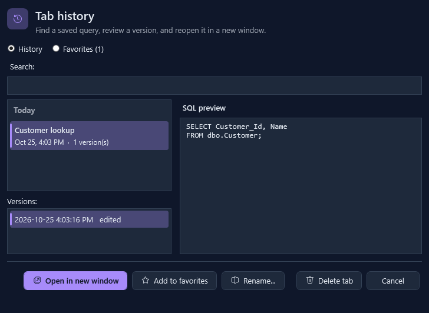
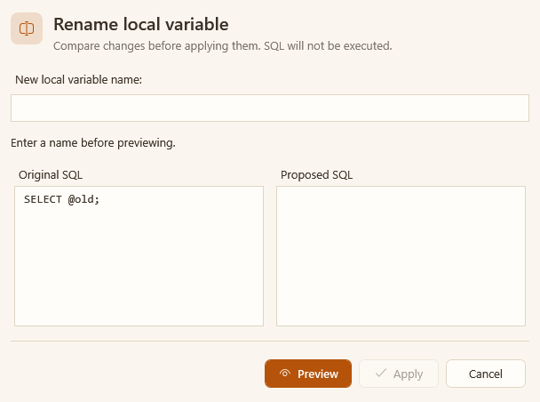
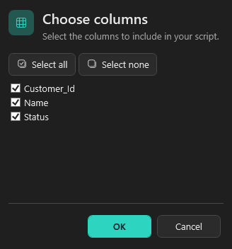
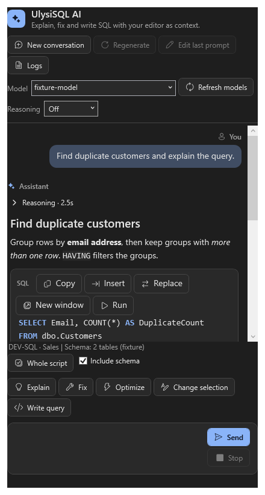

# UlysiSQL

A free, open-source productivity extension for **SQL Server Management Studio 22**.
It helps you write, format, check and refactor T-SQL faster, right inside the SSMS query editor.

**Looking for a free alternative to Redgate SQL Prompt?** UlysiSQL is a free SQL Prompt alternative
for SSMS 22: SQL IntelliSense and autocomplete, a T-SQL formatter / SQL beautifier, snippets,
code analysis, refactoring, tab history, server colors and an optional AI assistant, with no license or subscription.

<table>
  <tr>
    <td width="50%"></td>
    <td width="50%"></td>
  </tr>
  <tr>
    <td></td>
    <td></td>
  </tr>
</table>

<sub>Screenshots are rendered by the UI tests, with sample data.</sub>

- **Never runs your SQL on its own.** Generated scripts open in a new window for you to review.
- **AI is optional.** Nothing goes to an AI provider until you set one up and use an AI command; you pick the provider.
- **Private by default.** Query and result logging stays off unless verbose diagnostics is enabled; credentials are redacted.
- **Looks the way you like.** Follow the SSMS theme, or pick a palette and accent color of your own.
- **MIT licensed.**

> Tested automatically against SSMS 22 on every build. Found a bug? Please [report it](https://github.com/ulysis022219/UlysiSQL/issues).

## New in UlysiSQL

UlysiSQL is the new name of Querywright, together with a redesigned interface.

- **Themes and accent colors.** Five themes (Follow SSMS, Light, Dark, Midnight, Warm light) and eight accent colors
  (Follow SSMS, Blue, Teal, Violet, Rose, Amber, Green, Graphite) for UlysiSQL dialogs and the AI panel. Set them under
  Tools > Options > UlysiSQL > General > Appearance. High contrast always uses system colors.
- **A cleaner look.** Dialogs and the AI panel open with a header that says what they do, buttons carry icons, and the
  main action stands out in the accent color. Icons come from Microsoft's Fluent UI System Icons.
- **Fixes and speed.** Format on save and Execute act only on the SQL tab you are in, the AI safety check catches
  trigger ENABLE/DISABLE, very deeply nested SQL no longer breaks analysis, and the AI panel, suggestions, auto-fix and
  wide tables are faster. Closed windows no longer hold on to memory.

**Coming from Querywright?** Querywright 1.0.31 and earlier cannot install UlysiSQL by itself: install it once by
hand as described under [Install](#install); later updates install from inside SSMS again. Your options, snippets,
tab history and AI key stay. An existing install keeps its data in `%LOCALAPPDATA%\Querywright`, while new installs
use `%LOCALAPPDATA%\UlysiSQL`. Comments written for Querywright keep working: `-- querywright-disable` and
`-- querywright:format off` mean the same as the new `-- ulysisql-disable` and `-- ulysisql:format off`.
If you changed the BEGIN/END block colors under Fonts and Colors or assigned your own keyboard shortcuts to
Querywright commands, set them again for UlysiSQL.

## Install

1. Download `UlysiSQL_v<version>.zip` from the [latest release](https://github.com/ulysis022219/UlysiSQL/releases/latest)
   (or just the `.vsix` next to it if you prefer installing it yourself).
2. Close SSMS 22, unzip, and double-click **Install.cmd**.
3. Start SSMS 22 and open a query window.

UlysiSQL tells you when a newer release is out (once a day; turn it off under
Tools > Options > UlysiSQL > Updates; check now with UlysiSQL > **Check for updates...**).
Click **Install update** in the notice: UlysiSQL downloads and verifies the release, then waits for you to save
your work and close SSMS. The updater installs it automatically; reopen SSMS when it reports success.
Your settings are kept. Older versions that only show **Download** need one manual update to get this feature.
How updates are checked: [update security](docs/update-security.md).

To uninstall, close SSMS and double-click `Uninstall.cmd`.

SSMS 18, 19 and 20 (experimental, built from source, not yet tested in SSMS): build `src/UlysiSQL.Ssms.Legacy`,
then run `scripts/Install-Legacy.ps1` from an elevated PowerShell with SSMS closed (`-Uninstall` removes it).

## What it does

**Writing SQL**
- Suggestions as you type: tables, views, columns and joins from the connected database. Columns are grouped per table in the current query scope (innermost subquery first), including UPDATE aliases, INSERT column lists and MERGE inserts.
  Press **Ctrl+Shift+D** to reload them after schema changes. Names and types are cached on disk (hashed file names, never credentials or data) so suggestions work right after a restart; turn it off with "Cache schema on disk". Very large databases load up to 100,000 columns by default; raise or remove the cap with "Live metadata row limit" (0 = no limit).
- Snippets: type a shortcut and press **Tab**, e.g. `ssf` + Tab gives `SELECT * FROM`. Lowercase `$name$` placeholders in a template are fields: Tab selects the next one, then goes to `$CURSOR$`; Esc stops.
  56 built in; add your own `.sql` files or share a team folder.
- Typing `'` inserts `''` with the cursor inside; typing `'` again steps over the closing quote (turn off under Tools > Options > UlysiSQL).
- Expand `*` into a column list, or pick the columns you want.
- **F12** jumps to where a variable, alias or CTE is declared; on a procedure, view, function or trigger it opens an ALTER script in a new query and on a table a CREATE TABLE script (also in scripts with syntax errors elsewhere), including three-part names in another database on the same server (`OtherDb.dbo.Proc`).
- **BEGIN/END pairs** are colored by nesting level (BEGIN/END, BEGIN TRY/END TRY, CASE/END, with their IF, WHILE or ELSE); the pair at the caret is highlighted, **Ctrl+]** jumps between them, and hovering an END shows the line that opened it. A BEGIN, CASE, END or parenthesis with no partner is underlined as you type.
- **Parameter hints**: after `EXEC dbo.Proc ` or `dbo.fn(` a tooltip lists the parameters with the current one in bold.
- **Folding**: `--region name` / `--endregion` sections and multi-line BEGIN/END blocks collapse from the margin.
- **Shift+F5** runs only the statement under the caret (only when you press it).
- Executing a **DELETE or UPDATE without WHERE** asks first ("Execute anyway" / "Don't execute"); turn it off in the prompt or under Tools > Options > UlysiSQL.
- **Production servers**: list patterns such as `prod;live` in Tools > Options > UlysiSQL; on a matching connection, executing DROP, ALTER, TRUNCATE or an unfiltered DELETE/UPDATE always asks first, and Run in multiple databases names matching databases in its prompt. #temp tables never trigger these prompts.

**Formatting**
- Format a selection, a whole document, or every `.sql` file in a folder. Optional **Format on save** (off by default) formats the document on Ctrl+S, and every unsaved SQL document on Save All.
- 13 style options with a live preview, saved to a file your team can share.
- Keyword casing, add/remove square brackets, qualify object names, insert semicolons.
- Lines between `-- ulysisql:format off` and `-- ulysisql:format on` stay exactly as written.

**Checking code**
- Hovering a column shows its type, NULL/NOT NULL and default from the cached metadata.
- 46 analysis rules, shown as squiggles while you type and in the Error List. Turn rules off or change their severity in **Formatting style and rules...** > Analysis rules (saved to the shared settings file), or in the script with `-- ulysisql-disable` comments ([analysis rules](docs/analysis-rules.md)).
- Quick fixes for common issues, one at a time or all at once.
- Find unused variables and parameters, and invalid objects in the database (read-only).

**Refactoring** (always as a script you review, never executed)
- Rename a variable or table alias.
- Rename a database object together with the code that depends on it.
- Split a table, or wrap a selection as a stored procedure.

**Everyday helpers**
- Tab history: every SQL window keeps timestamped versions (a few seconds after each edit, and on execute), grouped per tab with a preview; search covers every saved version; reopen any version, even after a restart (toolbar button next to New Query). Keeps the newest 100 versions per tab, 200 tabs and 256 MB in all (favorites aside); PASSWORD and SECRET literals, password variables and the arguments of password procedures (sp_addlogin, sp_password, sp_addlinkedsrvlogin and similar) are saved as `***`.
- Select several cells in a results grid to see count, sum, average, min and max in the status bar.
- A colored strip and a `server · database` label on every query window, so you always know
  where you are connected. Right-click a server in Object Explorer > **UlysiSQL: server color...**
  to pick its color, or write rules like `prod=Red;test=Orange` in Tools > Options.
- Highlight an object name, right-click > **UlysiSQL: compare object with database...** to check it against
  another database on the same server: a message if identical, otherwise a side-by-side diff.
- Results grid right-click: copy as `IN (...)`, script rows as `INSERT`, open in Excel, save as CSV.

**AI assistant (optional)**
- A dockable chat panel (**Alt+Z**) that writes, explains, fixes and optimizes SQL with your query window as context,
  plus **AI: explain SQL**, **AI: fix errors**, **AI: optimize query** and **AI: complete at caret**.
- Works with the provider you choose: DeepSeek by default, any OpenAI-compatible service (OpenAI, OpenRouter, Groq,
  Mistral, a local Ollama or LM Studio), or the Anthropic API. Set it up under Tools > Options > UlysiSQL > AI.
  Your API key is encrypted for your Windows account and never shown again.
- Only what an AI command needs is sent: your prompt, the script or selection, and the definitions of the tables it
  mentions. Table data is never sent by the panel. Fix and Optimize compile with `SET NOEXEC ON` or read the estimated
  plan, so nothing runs.
- Every SQL block in an answer has Copy, Insert, Replace, New window and Run; Run asks first by default.
- An optional **MCP server** (off by default) lets an agent such as Claude Code or Cursor work with your open query window.
  Its `execute_sql` tool really runs SQL with your login, so each script is shown for a Yes/No first unless you turn that off.

Details: [AI assistant and MCP server](docs/ai.md).

All commands are in the **Tools** menu under "UlysiSQL". Settings are under
**Tools > Options > UlysiSQL**; every feature above can be switched off there.
Full lists: [features](docs/features.md), [analysis rules](docs/analysis-rules.md) and
[SQL Prompt comparison](docs/sql-prompt-parity.md).

## Privacy

- Your scripts run only when you press a key or click. The AI panel's Run button and the MCP server's `execute_sql`
  ask first by default.
- The schema cache holds names and types only, under hashed file names; never credentials or table data.
- The daily update check only asks GitHub for the latest release; it sends no query text or connection details.
- Diagnostics are off by default. When you turn on verbose diagnostics, logs stay in memory, are bounded, and clear when
  you turn it off or close SSMS; API keys and common credential fields are redacted.

## Build from source

Requires the .NET 10 SDK on Windows.

```powershell
dotnet run --project tests/UlysiSQL.Checks                     # core checks
dotnet build src/UlysiSQL.Ssms/UlysiSQL.Ssms.csproj            # builds the .vsix
powershell -NoProfile -File scripts/Test-Package.ps1           # checks the package contents
powershell -NoProfile -File scripts/Test-Update.ps1            # update validation, no installation
powershell -NoProfile -STA -File scripts/Test-Dialogs.ps1 -Scale 150 -Theme Midnight -Accent Violet -Out shots  # dialog screenshots
```

The package is written to `src/UlysiSQL.Ssms/bin/Debug/net472/UlysiSQL.Ssms.vsix`.

- `src/UlysiSQL.Core`: parsing, formatting, analysis and refactoring (.NET Standard 2.0, no SSMS dependency).
- `src/UlysiSQL.Ssms`: the SSMS 22 extension (.NET Framework 4.7.2), including themes (`Theme.cs`) and icons (`Icons.cs`).
- `src/UlysiSQL.Ssms.Legacy`: the experimental SSMS 18-20 build of the same sources.
- `tests/UlysiSQL.Checks`: the core checks.
- `scripts/Test-Dialogs.ps1` and `scripts/Test-AiPanel.ps1`: offscreen checks of the dialogs and AI panel at 100-200% scaling; `-Out` saves screenshots.
- `scripts/Test-Ssms.ps1`: the end-to-end tests that drive a real SSMS 22 in CI.

Every push builds the extension and runs the SSMS tests on GitHub Actions. To publish a release,
run the **Build VSIX** workflow with a tag such as `v1.0.30`; it is published only if the tests pass, with SHA-256
checksums of the zip and .vsix in the release notes.

## Contributing

Issues and pull requests are welcome. When reporting a bug, use the error line UlysiSQL shows
(version, command and error type). For detailed debugging, enable **Tools > Options > UlysiSQL > General > Verbose diagnostics**, reproduce the problem, then open **UlysiSQL AI > Logs > Export logs**.
Capture is off by default. Logs include UlysiSQL commands, background activity, query and result text, AI request/response text, errors, timing, and provider token/finish metadata. API keys and common credential fields are redacted. Review exports before sharing: database text can still contain sensitive data.
**Import logs** opens a validated, read-only snapshot; it does not change settings, send requests, or execute queries. Logs live in memory, expire at bounded limits, and clear when capture is switched off or SSMS exits.
Text capture is limited to 128 KiB per event; grid samples contain at most 100 rows / 4,096 cells. Truncation is marked. Native SSMS operations outside UlysiSQL, including F5 execution, are not traced.

Ground rules for changes: no automatic query execution or database changes. Credential logging is forbidden; query and result logging requires the explicit verbose diagnostics option.

## Credits

- [Microsoft.SqlServer.TransactSql.ScriptDom](https://github.com/microsoft/SqlScriptDOM) parses T-SQL (MIT).
- [Fluent UI System Icons](https://github.com/microsoft/fluentui-system-icons) by Microsoft (MIT), embedded as path data.

Notices are in [THIRD-PARTY-LICENSES](THIRD-PARTY-LICENSES/README.md).

## License

[MIT](LICENSE). UlysiSQL is an independent project, not affiliated with or endorsed by Microsoft or Redgate.
SQL Prompt is a trademark of Redgate Software Ltd; SQL Server Management Studio is a trademark of Microsoft.
Names are used only to describe compatibility and comparison.

<sub>Keywords: UlysiSQL, Querywright, free SQL Prompt alternative, SQL Prompt free, SSMS extension, SSMS 22 add-in,
SSMS plugin, SQL IntelliSense, SQL autocomplete, T-SQL formatter, SQL formatter for SSMS, SQL beautifier, SQL snippets,
SQL code analysis, T-SQL linter, SQL refactoring, SSMS tab history, SSMS server colors, SSMS dark theme,
AI SQL assistant, MCP server for SSMS, open source.</sub>
